

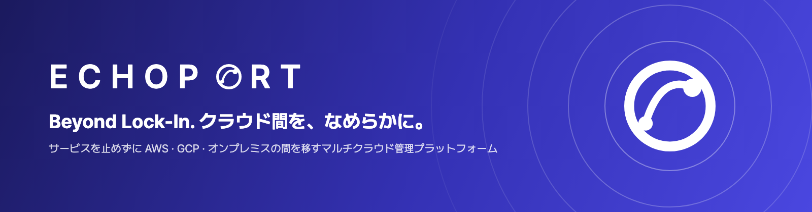

[app.echoport.uk](https://app.echoport.uk) · [API ドキュメント](https://api.echoport.uk/docs)

Team Echo · SoftBank Hackathon 2026 in Korea 本選 · 한국어는 페이지 맨 아래에 있어요

---

## EchoPortとは

EchoPortは、AWS・GCP・オンプレミスのクラスターを一つの画面で管理し、災害が来る前に稼働中のサービスを止めずに安全な環境へ移し、災害が終わったら元へ戻すマルチクラウド管理プラットフォームです。

ユーザーがアクセスするアドレスは変わりません。その裏でトラフィックを10 → 50 → 100%と移し、段階ごとに移行先のリクエスト数と5xxを判定します。判定に失敗すると、自動で元の環境に戻します。

  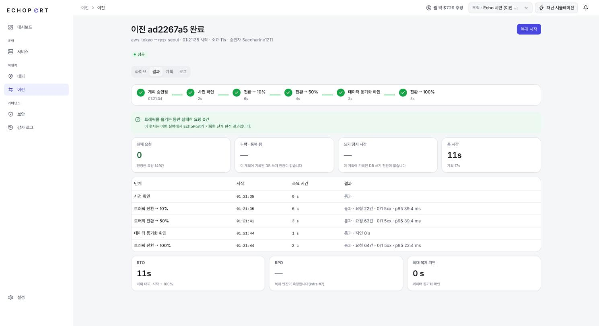
   運用環境の緊急移行の結果: AWS 東京 → GCP ソウル 11秒、判定したリクエスト149件中失敗0件

## なぜ必要か

- 一つの地域に依存すると、一緒に止まります。災害や事業者の障害が起きると、その地域のサービスがまとめて影響を受けます。
- 既存のツールは境界の中で切り替えます。一つのプラットフォーム、一つのクラスター、一つのクラウドの中ならうまくいきますが、クラウドの境界を越えてトラフィック・データ・ロールバックを一つの流れにまとめたサービスは、私たちの調査範囲では見つかりませんでした。
- 移した後も守る必要があります。環境が変わっても同じセキュリティ基準を守れているか、誰が何を承認したかを残す必要があります。

| 機能 | 参考にしたサービス | EchoPortの違い |
|---|---|---|
| デプロイ | Railway · Northflank | クラウドとオンプレミスを同じ操作で扱い、予備環境が同じバージョンに追従します |
| 固定エントリ | Railway · Argo Rollouts | 二つのクラウドの前に Envoy を置き、DNS の TTL を待ちません |
| 段階的な切り替え | Argo Rollouts | クラウドの境界を越えて比率を切り替え、リクエスト件数で判定します |
| データ移行 | AWS DMS · Google DMS | 事業者に縛られない PostgreSQL 論理レプリケーションと PgBouncer を使います |
| 計画と承認 | Railway · IaC の plan/apply | 計画の後に環境が変わると、古い計画として拒否します |
| セキュリティ | Wiz · SCC · Defender | 同じ統制を全環境に適用し、ゲートが移行を止めます |
| エージェント | E2B · Railway Agent | 隔離サンドボックスと人の承認を前提にし、運用環境は読み取りのみです |

## システムアーキテクチャ

  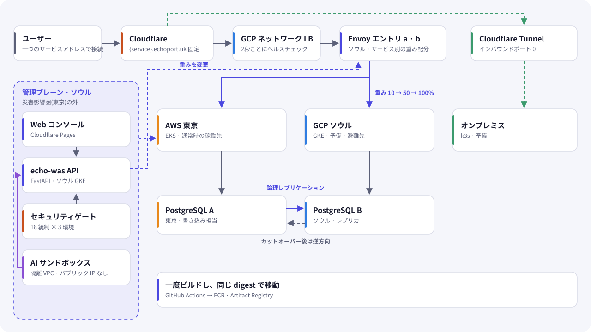

システムは、利用者のリクエストが通るデータプレーンと、それを動かす管理プレーンに分かれています。

| 層 | 構成 | 役割 |
|---|---|---|
| エントリ | Cloudflare → GCP ネットワーク LB → Envoy a · b | アドレスを固定し、環境ごとの比率を切り替えて、リクエストと5xxを数えます |
| 実行環境 | AWS 東京(EKS) · GCP ソウル(GKE) · オンプレミス(k3s) | サービスが動く場所です。どの環境にも同じ digest のイメージが載ります |
| データ | PostgreSQL 論理レプリケーション + PgBouncer | 東京からソウルへ複製し、切り替え時に書き込み先を移します |
| 管理プレーン | echo-was API · ワーカー · PostgreSQL(ソウル) | 何がどこで動いているかの記録を持ち、デプロイと移行を実行します |
| AI | 隔離サンドボックス VM(ソウル) | 運用環境と接続のない別ネットワークで事前点検を実行します |
| コンソール | Cloudflare Pages | 操作する画面です。API だけを呼びます |

- 管理プレーンはデモの災害地域の外に置きます。デモの災害地域は東京で、API と AI サンドボックスはソウルにあります。
- オンプレミスはインバウンドのポートを開けません。Cloudflare Tunnel で外向きに接続します。
- 秘密の値は位置だけを記録します。値は GCP Secret Manager に置き、CI は OIDC で認証するのでクラウドの鍵を保存しません。

## パート別の設計

### 1. 固定エントリとトラフィック切り替え

`echo-infra/entrypoint` · 担当: インフラ

`{service}.echoport.uk` はいつも同じ Envoy に届きます。切り替えには二つの仕組みがあり、目的が違います。

| 場面 | 仕組み | 動き |
|---|---|---|
| 計画された移行 | 重み | ワーカーが重みを渡すと routes.yaml が書き換えられ、Envoy は再起動なしで読み直します |
| 突然の障害 | アクティブヘルスチェック | 2秒間隔で2回失敗すると、比率が90/10でも全トラフィックを生きている環境に送ります |

DNS の重みではなくプロキシを選んだ理由は三つです。設定がすぐ効くこと、環境ごとのリクエスト数と5xxを数えて件数判定に使えること、特定の事業者に依存しないことです。代わりに1ホップ増え、プロキシ自体が単一障害点になるので、別ゾーンに2台置いて GCP のネットワーク LB で束ねました。b は a の重みを2秒ごとに同期し、a が死ぬと最後の値を維持します。

環境ごとのリクエスト・エラー・遅延は Prometheus と Grafana で見られます。オプションのリクエストジャーナルは、Envoy の ext_authz を通して直近15分の書き込みを SQLite に記録し、元の DB が急に失われたときに昇格後に再生します。既定ではオフです。

### 2. データ移行

`echo-infra/replication` · 担当: インフラ · データ

トラフィックを移しても、書き込み先が残っていれば移行は終わりません。PostgreSQL の論理レプリケーションで東京(A)からソウル(B)へ複製し、アプリは PgBouncer を通して接続します。事業者の移行サービスを使わないので、クラウドが変わっても同じ手順です。

書き込みの切り替えは次の順に進みます。

1. PgBouncer で書き込みを PAUSE します
2. 複製が追いつくのを待ちます
3. シーケンスを合わせます。論理レプリケーションはシーケンスを動かさないので、最大 id に余裕を足して B に設定します
4. サブスクリプションを止めます
5. 接続先を B に向け直して RELOAD し、RESUME します

切り替えの後は B から A への逆方向の複製を作り、復帰に備えます。切り替えの Job は、ソウルの GKE の専用 namespace で専用の ID と RBAC を持って動きます。元の DB が死んだ場合は、昇格とリクエストジャーナルの再生を組み合わせた別の手順を使います。

### 3. 管理プレーン API

`echo-was` · 担当: API サーバー

FastAPI と PostgreSQL で作った記録の持ち主です。どのサービスのどのバージョンがどの環境で何%を受けているかを持ち、実際の作業はワーカーが実行します。

- ワーカーはジョブテーブルを `SKIP LOCKED` とリースでポーリングします。冪等キーがあるので、ワーカーが途中で死んでも同じ作業が二度走りません。API とワーカーは同じイメージです。
- 環境の種類ごとの違いはアダプターの中に閉じ込めています。実行機は本物と偽物を差し替えられ、テストとリハーサルで失敗を注入できます。
- ログインは GitHub App で、セッションは httpOnly クッキーです。役割は Viewer < Developer < Admin で、エージェントのトークンは GET と HEAD しか通りません。
- デプロイは QUEUED → BUILDING → DEPLOYING → VERIFYING と進みます。コミットを40文字の SHA で固定し、同じコミットならビルドを再利用します。失敗すると前のバージョンを残し、予備環境は同じビルドで自動的に追従します。
- アプリの環境変数は書き込み専用です。値は Secret Manager にだけ置き、デプロイの記録にはバージョンを固定します。
- 監査ログは UPDATE と DELETE をトリガーで止めています。人・エージェント・システムの行動と、403 で拒否された試みも残ります。

移行計画はこの API の中心です。

| 段階 | 内容 | 判定 |
|---|---|---|
| 0 | 事前確認 | 計画のフィンガープリントと環境の状態 |
| 1 | 10% | 移行先で20件 |
| 2 | 50% | 移行先で50件 |
| 3 | データ確認 | 複製の同期 |
| 4 | 100% | 移行先で50件 |

各段階は最大30秒待ちます。判定の失敗、判定不能、適用の失敗、中止、ワーカーの喪失はすべて、元の環境100%へのロールバックになります。時間ではなく件数で判定するのは、静かなサービスでも結果を確定させるためです。

計画のフィンガープリントは承認時とワーカーの開始時に比べ、環境が変わっていれば古い計画として止めます。承認の有効期限は24時間で、承認は別の開発者が行います。組織の設定で自己承認も許可できます。計画の種類(PLANNED · EMERGENCY · FAILBACK)はサーバーが決めます。

災害は震源と規模から影響範囲を計算し、基準を超えるとサービスごとに計画を作ります。USGS の地震フィードにも接続できますが、既定ではオフです。このほか、推定と請求を分けたコスト API、Prometheus から読むサービス指標、AI データの所在サマリーを提供します。

### 4. インフラとオンプレミス

`echo-infra` · 担当: インフラ

Terraform で EKS、GKE、ネットワーク、エントリを管理します。`terraform/environments` に環境ごとの定義を置き、人が plan を確認してから apply します。実行の認証は OIDC と Workload Identity Federation を使います。リポジトリ間で受け渡す値は `contracts/` に出力の契約として固定しています。

オンプレミスは Linux の機器に `install.sh` で k3s を入れ、Cloudflare Tunnel で接続します。インバウンドのポートは0です。デモではソウルの EC2 をオンプレミスに見立てています。

### 5. セキュリティゲート

`echo-was` のセキュリティサービスと `echo-infra` · 担当: セキュリティ

環境が変わっても同じ基準を守れているかを、証拠で判定します。18統制 × 3環境を IAM · 暗号化 · 監査ログ · ポリシーの4つの欄にまとめて表示します。

| 証拠の出どころ | 例 |
|---|---|
| ビルド | Trivy で修正可能な HIGH · CRITICAL が0件か、gitleaks |
| 接続 | 定期的な TLS 試験 |
| 実行環境 | Kubernetes とクラウド API の設定 |
| 記録 | CI と監査ログ |
| AI | 事前点検の結果 |

- 結果は PASS · WARN · FAIL · N/A · UNKNOWN です。確かめていないものを通過とは数えません。
- ゲートは承認時とワーカーの開始時に判定し、実行直前にイメージ、TLS、環境変数のキーを移行元と移行先で確認します。
- `simulated=true` の値は証拠になりません。
- 失敗を免除できるのは、期限があり人が承認した例外だけです。
- 手動の承認にも、事前承認した災害対応にも同じ統制が効きます。
- 比較 API の `blocksMigration` をコンソールと共有するので、画面とサーバーの判定が同じです。

### 6. AIエージェントとサンドボックス

`echo-ai-agent` · 担当: AI

移行の前に、二つの環境の違いをルールと AI で点検します。AI を信じて動かすのではなく、AI が失敗しても影響がない形に閉じ込めています。

- ランナーは運用と接続のない別の VPC の VM で動き、権限のないサービスアカウントを使います。
- 実行のたびに新しいコンテナを作り、終わると消します。ネットワークなし、読み取り専用、非 root、秘密の値なしです。
- まずルールで環境の種類、設定キー、イメージの digest、変数名、最近の検出を比べます。次に Claude を1回呼びます。ツールは渡さず、構造化出力で、入力は許可リストの項目だけです。入力はデータとしてタグで囲みます。
- AI の指摘はすべて WARN です。AI が PASS を出すことはできません。
- モデルが失敗または拒否したときは、ルールの結果だけを返します。
- どの場所から、どのモデルに、どの区分のデータが何バイト送られたかを記録します。

人が承認したパッチをサンドボックスで適用し、ビルド、Trivy、ネットワークなしのヘルスチェックまで行う機能も作りましたが、今の運用ランナーではオフです。

### 7. Webコンソール

`echo-frontend` · 担当: フロントエンド

Vite、React 19、TypeScript で作り、Cloudflare Pages に配信します。データは画面 → クエリフック → openapi-fetch → API の一方向に流れ、サーバーの状態は TanStack Query だけが持ちます。型は運用の OpenAPI から生成するので、API が変わると型エラーで分かります。

- 組織の概要から、サービスごとの作業空間(概要 · デプロイ · 変数 · 指標 · 移行 · 設定)へ進みます。
- トポロジーは React Flow と elkjs、災害地図と地球儀は d3-geo で描きます。
- 知らない enum の値が来ても中立のバッジで表示し、画面は壊れません。
- 偽の値には `simulated` バッジを付け、測っていない値は `—` のままにします。
- 権限のないボタンは隠さず、無効にして理由を出します。
- 英語・韓国語・日本語に対応します。
- ステージではスマートフォンのリモコン画面を QR で開いて災害を起こします。

### 8. デモアプリ

`echo-demo-app` · `echo-demo-db` · 担当: API サーバー

移行で何も失わなかったことを、目で確かめるためのアプリです。

echo-demo-app は順番に番号を書き込みます。番号に UNIQUE 制約があり、どの環境が書いたかも残すので、切り替えの前後で欠落と重複を数えられます。画面には現在の番号、応答した環境、直近60件の色の帯が出ます。

echo-demo-db は在庫と注文のアプリです。在庫10のりんごを東京だけで2個注文し、東京の DB を止めてソウルを昇格します。結果の複製だけでは在庫10・注文0に戻りますが、リクエストの再生を使うと在庫8・注文2になります。同じ Idempotency-Key は二度適用されません。

## 移行の流れ

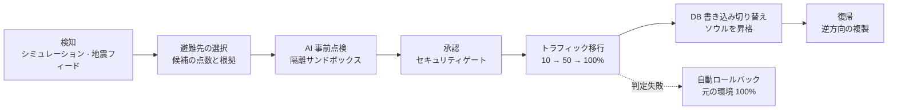

1. 災害のシミュレーションまたは地震フィードから、影響を受ける環境を判定します
2. 安全 · 容量 · 費用 · 復帰時間 · データの場所で候補に点数を付け、根拠を見て移行先を選びます
3. サンドボックスで二つの環境を比べます
4. セキュリティゲートを通ると、人が承認できます
5. 比率を段階的に移し、段階ごとに判定します。失敗すると自動で戻します
6. 書き込みを止め、複製が追いついたらソウルの DB を昇格します
7. 災害が終わると、逆方向の複製を使って元の環境に戻ります。災害が終わっていない地域には戻れません

## 実測結果

実際に測った値だけを、測定場所とともに記載しています。

| 項目 | 結果 | 測定 |
|---|---|---|
| 緊急移行 | AWS 東京 → GCP ソウル 11秒、判定したリクエスト149件中失敗0件 | 運用 · 11/7 01:21 |
| 障害注入の自動ロールバック | 1.5秒 | リハーサル · テスト用実行機 |
| DB 書き込み切り替え | 書き込み停止 7.97秒、A 168行 = B 168行(欠落0 · 重複0) | 運用リハーサル · 11/4 · 毎秒10件の書き込み |
| DB 復帰 | 9.42秒、欠落0 · 重複0 | 運用リハーサル · 11/4 |
| エントリの障害切り替え | VM a → b 3.8秒(失敗リクエスト12件) | 11/6 |

## 設計原則

| 原則 | 実装 |
|---|---|
| 失敗の既定は元に戻すこと | 判定不能でもワーカーの喪失でも、元の環境100%に戻します |
| 判定は測れる値で | 時間ではなくリクエスト件数と5xxで判定します |
| 古い判断で動かない | フィンガープリントが変わった計画は実行しません |
| 確かめていないものは通さない | UNKNOWN も `simulated` の証拠も通過になりません |
| AI は提案だけ | AI は WARN しか出せず、運用環境に書き込めません |
| 記録は消せない | 監査ログは DB のトリガーで変更と削除を止めています |
| 秘密の値は持たない | 値は Secret Manager に置き、API は書き込み専用です |
| 偽物は偽物と言う | 画面に `simulated` と出し、測っていない値は空けておきます |

## 制約と次の課題

| 現在 | 次の段階 |
|---|---|
| 書き込み停止は実測約8秒で、設計目標の1秒より長いです | 逆方向のサブスクリプションを先に作っておく案を検討しています |
| 書き込み負荷をかけた測定は7.97秒のリハーサル1回です。166件中5件がクライアントの10秒タイムアウトになり、そのうち4件は DB に反映されました | 測定回数を増やし、クライアントの再試行と冪等性を確かめます |
| 複製が非同期なので、突然の障害では最後の書き込みを失う可能性があり、RPO は0ではありません | リクエストジャーナルの再生で失う範囲を減らします |
| 災害はシミュレーションで、地震フィードは既定でオフです。ただしその災害が始めた移行は実際の移行です | 運用で地震フィードをオンにする基準を決めます |
| オンプレミスはまだ Envoy の重み切り替えの対象ではありません | 接続先の設定に1行追加して対象にします |
| エントリ2台はどちらもソウルにあります | 別のクラウドに3台目を置きます。コードはあり、適用はしていません |
| サンドボックスのパッチ適用はオフです | ランナーに必要な権限とツールを入れます |
| デプロイ失敗の AI 診断は、ランナー接続前なので偽の結果で、`simulated` バッジで明示します | ランナーを接続します |

## 画面

<table>
<tr>
<td width="50%">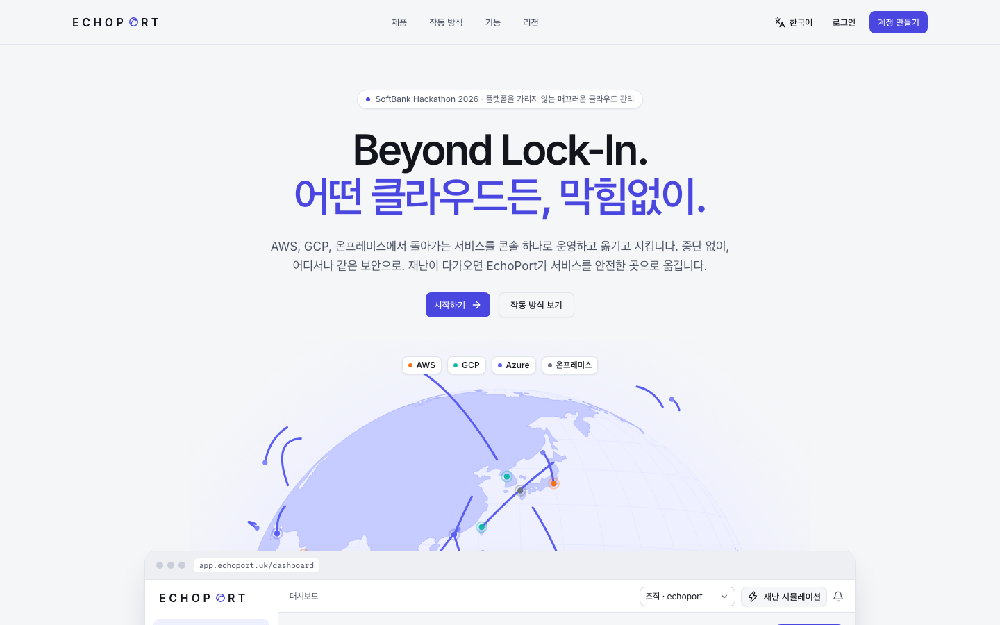 紹介: 地球儀の上に環境を表示します</td>
<td width="50%">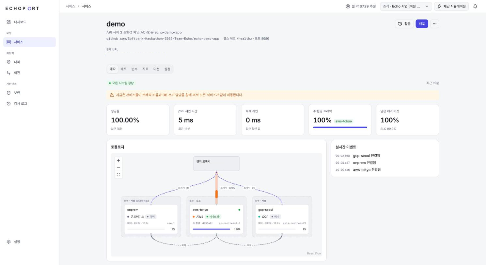 サービス概要: 指標と環境ごとのトラフィック</td>
</tr>
<tr>
<td width="50%"> 移行結果: 段階ごとの判定と RTO</td>
<td width="50%">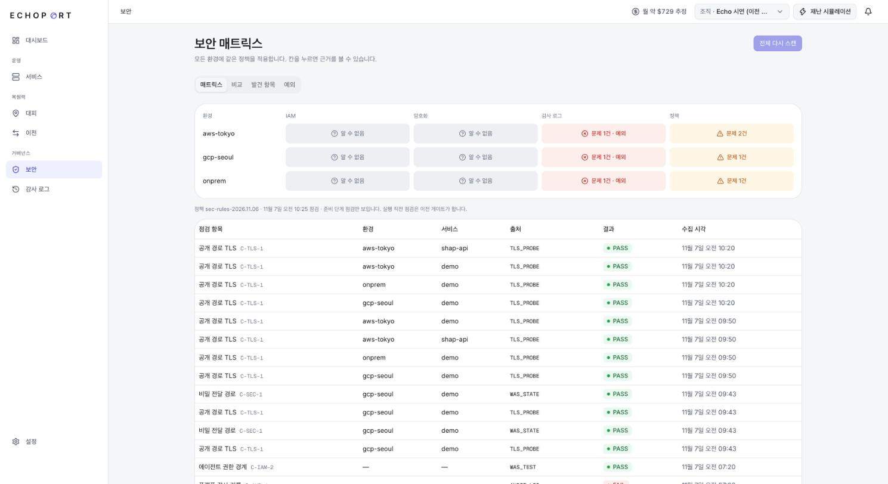 セキュリティマトリクス: 環境ごとの判定と証拠</td>
</tr>
</table>

運用環境の画面です。サービスのアドレスの一部を隠しています。

## デザイン

  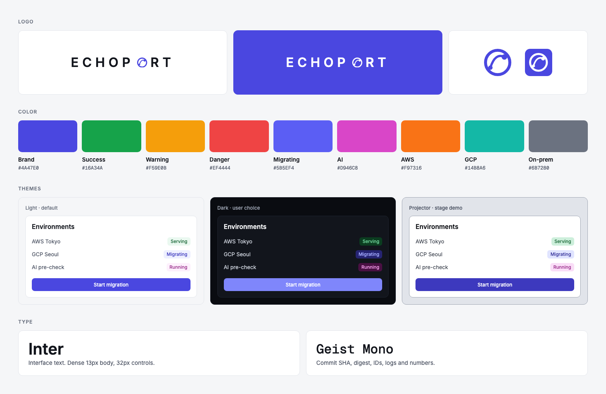

- ワードマーク PORT の O は、二つの地点を弧で結ぶ地球儀です。環境の間を移るサービスを表します。
- 色は意味にだけ使います。ブランド色は主ボタンと選択状態のみで、状態は色と文字を必ず併記します。
- テーマはライト · ダーク · プロジェクターの3つです。プロジェクターはステージの画面用で、コントラストが高く文字が一段大きくなります。
- 色 · 余白 · 文字 · 角丸 · 影は Figma 変数から出力した `--ep-*` トークンだけを使います。

## リポジトリ

| リポジトリ | 内容 |
|---|---|
| [echo-frontend](https://github.com/Softbank-Hackathon-2026-Team-Echo/echo-frontend) | Web コンソール |
| [echo-was](https://github.com/Softbank-Hackathon-2026-Team-Echo/echo-was) | 管理プレーン API · ワーカー · セキュリティゲート |
| [echo-infra](https://github.com/Softbank-Hackathon-2026-Team-Echo/echo-infra) | Terraform · エントリ · データレプリケーション · オンプレミス |
| [echo-ai-agent](https://github.com/Softbank-Hackathon-2026-Team-Echo/echo-ai-agent) | AI エージェントのランナーとサンドボックス |
| [echo-demo-app](https://github.com/Softbank-Hackathon-2026-Team-Echo/echo-demo-app) | 連番の書き込みで欠落と重複を確かめるデモアプリ |
| [echo-demo-db](https://github.com/Softbank-Hackathon-2026-Team-Echo/echo-demo-db) | リクエスト再生を確かめるデモアプリ |
| [echo-secure](https://github.com/Softbank-Hackathon-2026-Team-Echo/echo-secure) | セキュリティとガバナンスの案内。コードは echo-was · echo-infra にあります |
| [.github](https://github.com/Softbank-Hackathon-2026-Team-Echo/.github) | この紹介ページ |

## 技術スタック

| 領域 | スタック |
|---|---|
| Web | Vite · React 19 · TypeScript · TanStack Query · Tailwind CSS v4 · shadcn/ui · React Flow + elkjs · d3-geo · i18next · Sentry · Cloudflare Pages |
| API | Python 3.13 · FastAPI · Pydantic v2 · SQLAlchemy 2.0 · PostgreSQL 17 · Alembic · GKE · GitHub App |
| Infra | Terraform · EKS · GKE · k3s + Cloudflare Tunnel · Envoy · Prometheus · Grafana |
| Data | PostgreSQL 論理レプリケーション · PgBouncer · リクエストジャーナル |
| AI | Claude API · Docker サンドボックス · Trivy |
| Security | Trivy · Gitleaks · TLS 試験 · GCP Secret Manager · OIDC |

## 開発の進め方

- `main` に直接 push せず、イシューと PR で残します。
- API はサーバーの文書を基準にします。足りない項目は仮の名前で依頼し、提供する側が名前を決めます。
- 各リポジトリの `CLAUDE.md` に、何をなぜ選んだかを残します。取り消した決定も消しません。
- 他のパートの領域を変えるときは、先にチームで合意します。

## チーム

<table>
<tr>
<td align="center" width="20%"> キム・ドヨン リーダー · フロントエンド</td>
<td align="center" width="20%"> キム・ジミン API サーバー · デモアプリ</td>
<td align="center" width="20%"> ソ・ドンオク インフラ</td>
<td align="center" width="20%"> イ・ドヒョン インフラ · データ</td>
<td align="center" width="20%"> キム・ヒョンレ セキュリティ · AI</td>
</tr>
</table>

---

<h2>한국어</h2>

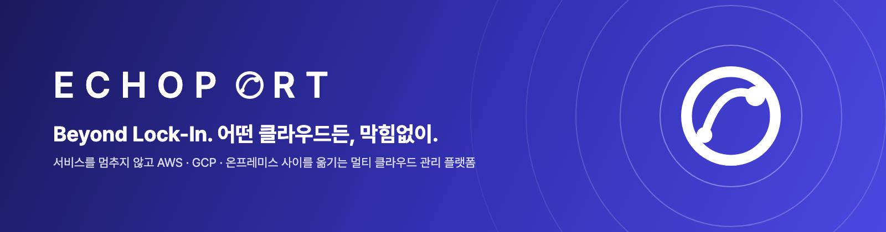

## EchoPort란

EchoPort는 AWS · GCP · 온프레미스 클러스터를 한 화면에서 관리하고, 재난이 오기 전에 가동 중인 서비스를 멈추지 않고 안전한 환경으로 옮겼다가 재난이 끝나면 되돌리는 멀티 클라우드 관리 플랫폼이에요.

사용자가 접속하는 주소는 그대로예요. 그 뒤에서 트래픽을 10 → 50 → 100%로 옮기고, 단계마다 도착 환경의 요청 수와 5xx를 판정해요. 판정에 실패하면 자동으로 원래 환경으로 되돌려요.

## 왜 필요한가요

- 한 지역에 묶이면 함께 멈춰요. 재난이나 공급자 장애가 나면 그 지역의 서비스가 한꺼번에 영향을 받아요.
- 기존 도구는 경계 안에서 전환해요. 한 플랫폼, 한 클러스터, 한 클라우드 안에서는 잘 되지만, 클라우드 경계를 넘어 트래픽 · 데이터 · 롤백을 한 흐름으로 묶은 서비스는 저희 조사 범위에서 찾지 못했어요.
- 옮긴 뒤에도 지켜야 해요. 환경이 달라도 같은 보안 기준을 지키는지, 누가 무엇을 승인했는지 남아야 해요.

| 기능 | 참고한 서비스 | EchoPort가 다른 점 |
|---|---|---|
| 배포 | Railway · Northflank | 클라우드와 온프레미스를 같은 조작으로 다루고, 예비 환경이 같은 버전을 따라가요 |
| 고정 진입점 | Railway · Argo Rollouts | 두 클라우드 앞에 Envoy를 두고, DNS TTL을 기다리지 않아요 |
| 단계 전환 | Argo Rollouts | 클라우드 경계를 넘어 비율을 바꾸고, 요청 건수로 판정해요 |
| 데이터 이전 | AWS DMS · Google DMS | 공급자에 묶이지 않는 PostgreSQL 논리 복제와 PgBouncer를 써요 |
| 계획 · 승인 | Railway · IaC plan/apply | 계획 뒤 환경이 바뀌면 낡은 계획으로 거부해요 |
| 보안 | Wiz · SCC · Defender | 같은 통제를 전 환경에 적용하고, 게이트가 이전을 막아요 |
| 에이전트 | E2B · Railway Agent | 격리 샌드박스와 사람 승인을 전제로 하고, 운영은 읽기만 해요 |

## 시스템 아키텍처

  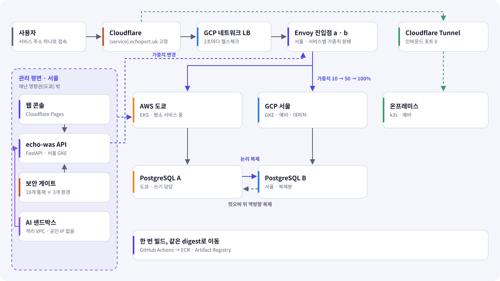

시스템은 사용자 요청이 지나가는 데이터 평면과, 그것을 움직이는 관리 평면으로 나뉘어요.

| 층 | 구성 | 역할 |
|---|---|---|
| 진입점 | Cloudflare → GCP 네트워크 LB → Envoy a · b | 주소를 고정하고, 환경별 비율을 바꾸고, 요청과 5xx를 세요 |
| 실행 환경 | AWS 도쿄(EKS) · GCP 서울(GKE) · 온프레미스(k3s) | 서비스가 도는 곳이에요. 어느 환경이든 같은 digest의 이미지가 올라가요 |
| 데이터 | PostgreSQL 논리 복제 + PgBouncer | 도쿄에서 서울로 복제하고, 전환할 때 쓰기 대상을 옮겨요 |
| 관리 평면 | echo-was API · 워커 · PostgreSQL(서울) | 무엇이 어디서 도는지 기록하고, 배포와 이전을 실행해요 |
| AI | 격리 샌드박스 VM(서울) | 운영과 연결이 없는 별도 네트워크에서 사전 점검을 돌려요 |
| 콘솔 | Cloudflare Pages | 조작하는 화면이에요. API만 불러요 |

- 관리 평면은 시연 재난 지역 밖에 둬요. 시연 재난 지역은 도쿄이고, API와 AI 샌드박스는 서울에 있어요.
- 온프레미스는 인바운드 포트를 열지 않아요. Cloudflare Tunnel로 바깥 방향으로 연결해요.
- 비밀값은 위치만 기록해요. 값은 GCP Secret Manager에 두고, CI는 OIDC로 인증해서 클라우드 키를 저장하지 않아요.

## 파트별 설계

### 1. 고정 진입점과 트래픽 전환

`echo-infra/entrypoint` · 담당: 인프라

`{service}.echoport.uk`는 언제나 같은 Envoy에 도착해요. 전환 방법은 두 가지이고 목적이 달라요.

| 상황 | 방법 | 동작 |
|---|---|---|
| 계획된 이전 | 가중치 | 워커가 가중치를 넘기면 routes.yaml이 바뀌고, Envoy는 재시작 없이 다시 읽어요 |
| 갑작스러운 장애 | 액티브 헬스체크 | 2초 간격으로 2번 실패하면, 비율이 90/10이어도 전체 트래픽을 살아 있는 환경으로 보내요 |

DNS 가중치 대신 프록시를 고른 이유는 세 가지예요. 설정이 바로 적용되고, 환경별 요청 수와 5xx를 세어 건수 판정에 쓸 수 있고, 특정 공급자에 묶이지 않아요. 대신 한 홉이 늘고 프록시 자체가 단일 장애점이 되어서, 다른 존에 두 대를 두고 GCP 네트워크 LB로 묶었어요. b는 a의 가중치를 2초마다 따라가고, a가 죽으면 마지막 값을 유지해요.

환경별 요청 · 오류 · 지연은 Prometheus와 Grafana로 봐요. 선택 기능인 요청 기록은 Envoy ext_authz를 거쳐 최근 15분의 쓰기를 SQLite에 남기고, 원본 DB가 갑자기 사라지면 승격 뒤에 다시 재생해요. 기본은 꺼져 있어요.

### 2. 데이터 이전

`echo-infra/replication` · 담당: 인프라 · 데이터

트래픽을 옮겨도 쓰기 대상이 남아 있으면 이전이 끝난 게 아니에요. PostgreSQL 논리 복제로 도쿄(A)에서 서울(B)로 복제하고, 앱은 PgBouncer를 거쳐 접속해요. 공급자의 이전 서비스를 쓰지 않아서 클라우드가 바뀌어도 절차가 같아요.

쓰기 전환은 이 순서로 진행해요.

1. PgBouncer에서 쓰기를 PAUSE해요
2. 복제가 따라잡기를 기다려요
3. 시퀀스를 맞춰요. 논리 복제는 시퀀스를 옮기지 않아서, 최대 id에 여유를 더해 B에 설정해요
4. 구독을 멈춰요
5. 접속 대상을 B로 바꿔 RELOAD하고 RESUME해요

전환 뒤에는 B에서 A로 역방향 복제를 만들어 복귀에 대비해요. 전환 Job은 서울 GKE의 전용 네임스페이스에서 전용 ID와 RBAC으로 돌아요. 원본 DB가 죽은 경우에는 승격과 요청 기록 재생을 묶은 별도 절차를 써요.

### 3. 관리 평면 API

`echo-was` · 담당: API 서버

FastAPI와 PostgreSQL로 만든 기록의 주인이에요. 어떤 서비스의 어떤 버전이 어느 환경에서 몇 %를 받는지 들고 있고, 실제 작업은 워커가 해요.

- 워커는 작업 표를 `SKIP LOCKED`와 리스로 폴링해요. 멱등 키가 있어서 워커가 중간에 죽어도 같은 작업이 두 번 돌지 않아요. API와 워커는 같은 이미지예요.
- 환경 종류별 차이는 어댑터 안에 가둬요. 실행기는 진짜와 가짜를 바꿀 수 있어서 시험과 리허설에서 실패를 주입할 수 있어요.
- 로그인은 GitHub App이고 세션은 httpOnly 쿠키예요. 역할은 Viewer < Developer < Admin이고, 에이전트 토큰은 GET과 HEAD만 통과해요.
- 배포는 QUEUED → BUILDING → DEPLOYING → VERIFYING으로 진행해요. 커밋을 40자 SHA로 고정하고, 같은 커밋이면 빌드를 다시 써요. 실패하면 이전 버전을 남기고, 예비 환경은 같은 빌드로 자동으로 따라가요.
- 앱 환경 변수는 쓰기 전용이에요. 값은 Secret Manager에만 두고 배포 기록에 버전을 고정해요.
- 감사 로그는 UPDATE와 DELETE를 트리거로 막아요. 사람 · 에이전트 · 시스템의 행동과 403으로 거부된 시도도 남아요.

이전 계획이 이 API의 중심이에요.

| 단계 | 내용 | 판정 |
|---|---|---|
| 0 | 사전 확인 | 계획 지문과 환경 상태 |
| 1 | 10% | 도착 환경 20건 |
| 2 | 50% | 도착 환경 50건 |
| 3 | 데이터 확인 | 복제 동기화 |
| 4 | 100% | 도착 환경 50건 |

단계마다 최대 30초를 기다려요. 판정 실패, 판정 불가, 적용 실패, 중단, 워커 유실은 모두 출발 환경 100%로 롤백돼요. 시간이 아니라 건수로 판정하는 이유는 조용한 서비스에서도 결과를 정하기 위해서예요.

계획 지문은 승인할 때와 워커가 시작할 때 비교하고, 환경이 바뀌었으면 낡은 계획으로 멈춰요. 승인 유효 기간은 24시간이고 승인은 다른 개발자가 해요. 조직 설정으로 자기 승인을 허용할 수도 있어요. 계획 종류(PLANNED · EMERGENCY · FAILBACK)는 서버가 정해요.

재난은 진원지와 규모로 영향 범위를 계산하고, 기준을 넘으면 서비스별로 계획을 만들어요. USGS 지진 피드도 연결할 수 있지만 기본은 꺼져 있어요. 이 밖에 추정과 청구를 나눈 비용 API, Prometheus에서 읽는 서비스 지표, AI 데이터 위치 요약을 제공해요.

### 4. 인프라와 온프레미스

`echo-infra` · 담당: 인프라

Terraform으로 EKS, GKE, 네트워크, 진입점을 관리해요. `terraform/environments`에 환경별 정의를 두고, 사람이 plan을 확인한 뒤 apply해요. 실행 인증은 OIDC와 Workload Identity Federation을 써요. 저장소 사이에서 주고받는 값은 `contracts/`에 출력 계약으로 고정해요.

온프레미스는 Linux 기기에 `install.sh`로 k3s를 깔고 Cloudflare Tunnel로 연결해요. 인바운드 포트는 0개예요. 시연에서는 서울의 EC2를 온프레미스로 보고 써요.

### 5. 보안 게이트

`echo-was`의 보안 서비스와 `echo-infra` · 담당: 보안

환경이 달라도 같은 기준을 지키는지 증거로 판정해요. 18개 통제 × 3개 환경을 IAM · 암호화 · 감사 로그 · 정책 4칸으로 묶어 보여 줘요.

| 증거 출처 | 예 |
|---|---|
| 빌드 | Trivy에서 고칠 수 있는 HIGH · CRITICAL이 0건인지, gitleaks |
| 연결 | 주기적인 TLS 시험 |
| 실행 환경 | Kubernetes와 클라우드 API의 설정 |
| 기록 | CI와 감사 로그 |
| AI | 사전 점검 결과 |

- 결과는 PASS · WARN · FAIL · N/A · UNKNOWN이에요. 확인하지 않은 것을 통과로 세지 않아요.
- 게이트는 승인할 때와 워커가 시작할 때 판정하고, 실행 직전에 이미지, TLS, 환경 변수 키를 출발과 도착에서 확인해요.
- `simulated=true` 값은 증거가 되지 않아요.
- 실패를 면제할 수 있는 건 기한이 있고 사람이 승인한 예외뿐이에요.
- 수동 승인에도, 미리 승인한 재난 대응에도 같은 통제가 걸려요.
- 비교 API의 `blocksMigration`을 콘솔과 함께 써서 화면과 서버의 판정이 같아요.

### 6. AI 에이전트와 샌드박스

`echo-ai-agent` · 담당: AI

이전 전에 두 환경의 차이를 규칙과 AI로 점검해요. AI를 믿고 맡기는 대신, AI가 틀려도 영향이 없는 곳에 가둬요.

- 러너는 운영과 연결이 없는 별도 VPC의 VM에서 돌고, 권한 없는 서비스 계정을 써요.
- 실행할 때마다 새 컨테이너를 만들고 끝나면 지워요. 네트워크 없음, 읽기 전용, 비 root, 비밀값 없음이에요.
- 먼저 규칙으로 환경 종류, 설정 키, 이미지 digest, 변수 이름, 최근 발견 항목을 비교해요. 그다음 Claude를 한 번 불러요. 도구는 주지 않고, 구조화된 출력을 받고, 입력은 허용 목록의 항목만 보내요. 입력은 데이터로 태그에 감싸요.
- AI의 지적은 모두 WARN이에요. AI가 PASS를 낼 수는 없어요.
- 모델이 실패하거나 거부하면 규칙 결과만 돌려줘요.
- 어디서 어떤 모델로 어떤 등급의 데이터가 몇 바이트 나갔는지 기록해요.

사람이 승인한 패치를 샌드박스에서 적용하고, 빌드, Trivy, 네트워크 없는 헬스체크까지 하는 기능도 만들었지만 지금 운영 러너에서는 꺼 뒀어요.

### 7. 웹 콘솔

`echo-frontend` · 담당: 프론트엔드

Vite, React 19, TypeScript로 만들고 Cloudflare Pages로 배포해요. 데이터는 화면 → 쿼리 훅 → openapi-fetch → API 한 방향으로 흐르고, 서버 상태는 TanStack Query만 가져요. 타입은 운영 OpenAPI에서 생성해서 API가 바뀌면 타입 오류로 바로 드러나요.

- 조직 개요에서 서비스별 작업 공간(개요 · 배포 · 변수 · 지표 · 이전 · 설정)으로 들어가요.
- 토폴로지는 React Flow와 elkjs, 재난 지도와 지구본은 d3-geo로 그려요.
- 모르는 enum 값이 와도 중립 배지로 보여 주고 화면이 깨지지 않아요.
- 가짜 값에는 `simulated` 배지를 달고, 재지 않은 값은 `—`로 둬요.
- 권한이 없는 버튼은 숨기지 않고 비활성으로 두고 이유를 보여 줘요.
- 영어 · 한국어 · 일본어를 지원해요.
- 무대에서는 휴대폰 리모컨 화면을 QR로 열어 재난을 일으켜요.

### 8. 시연 앱

`echo-demo-app` · `echo-demo-db` · 담당: API 서버

이전하면서 아무것도 잃지 않았는지 눈으로 확인하는 앱이에요.

echo-demo-app은 순서대로 번호를 써요. 번호에 UNIQUE 제약이 있고 어느 환경이 썼는지도 남아서, 전환 전후의 누락과 중복을 셀 수 있어요. 화면에는 현재 번호, 응답한 환경, 최근 60건의 색 띠가 나와요.

echo-demo-db는 재고와 주문 앱이에요. 재고 10개인 사과를 도쿄에서만 2개 주문하고, 도쿄 DB를 멈춘 뒤 서울을 승격해요. 결과 복제만으로는 재고 10 · 주문 0으로 돌아가지만, 요청 재생을 쓰면 재고 8 · 주문 2가 돼요. 같은 Idempotency-Key는 두 번 적용되지 않아요.

## 이전 흐름

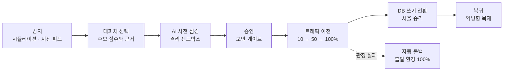

1. 재난 시뮬레이션이나 지진 피드로 영향 환경을 판정해요
2. 안전 · 용량 · 비용 · 복귀 시간 · 데이터 위치로 후보에 점수를 매기고, 근거를 보고 도착 환경을 골라요
3. 샌드박스에서 두 환경을 비교해요
4. 보안 게이트를 통과하면 사람이 승인할 수 있어요
5. 비율을 단계적으로 옮기고 단계마다 판정해요. 실패하면 자동으로 되돌려요
6. 쓰기를 멈추고 복제가 따라잡으면 서울 DB를 승격해요
7. 재난이 끝나면 역방향 복제로 원래 환경에 돌아와요. 재난이 끝나지 않은 지역으로는 돌아갈 수 없어요

## 실측 결과

실제로 잰 값만, 어디서 쟀는지와 함께 적었어요.

| 항목 | 결과 | 측정 |
|---|---|---|
| 긴급 이전 | AWS 도쿄 → GCP 서울 11초, 판정한 요청 149건 중 실패 0건 | 운영 · 11/7 01:21 |
| 실패 주입 자동 롤백 | 1.5초 | 리허설 · 시험용 실행기 |
| DB 쓰기 전환 | 쓰기 정지 7.97초, A 168행 = B 168행 (누락 0 · 중복 0) | 운영 리허설 · 11/4 · 초당 10건 쓰기 |
| DB 복귀 | 9.42초, 누락 0 · 중복 0 | 운영 리허설 · 11/4 |
| 진입점 장애 전환 | VM a → b 3.8초 (실패 요청 12건) | 11/6 |

## 설계 원칙

| 원칙 | 구현 |
|---|---|
| 실패의 기본값은 되돌리기 | 판정 불가든 워커 유실이든 출발 환경 100%로 돌아가요 |
| 판정은 잴 수 있는 값으로 | 시간이 아니라 요청 건수와 5xx로 판정해요 |
| 낡은 판단으로 움직이지 않기 | 지문이 바뀐 계획은 실행하지 않아요 |
| 확인 안 한 것은 통과 없음 | UNKNOWN도 `simulated` 증거도 통과가 되지 않아요 |
| AI는 제안만 | AI는 WARN만 낼 수 있고 운영에 쓰지 못해요 |
| 기록은 지울 수 없게 | 감사 로그는 DB 트리거로 수정과 삭제를 막아요 |
| 비밀값은 들고 있지 않기 | 값은 Secret Manager에 두고 API는 쓰기 전용이에요 |
| 가짜는 가짜라고 | 화면에 `simulated`를 달고, 재지 않은 값은 비워요 |

## 한계와 다음 과제

| 지금 | 다음 단계 |
|---|---|
| 쓰기 정지 실측이 약 8초로, 설계 목표 1초보다 길어요 | 역방향 구독을 미리 만들어 두는 안을 검토하고 있어요 |
| 쓰기 부하 측정이 7.97초 리허설 1회뿐이에요. 166건 중 5건이 클라이언트 10초 타임아웃이 났고, 그중 4건은 DB에 반영됐어요 | 측정 횟수를 늘리고 클라이언트 재시도와 멱등성을 확인해요 |
| 복제가 비동기라 갑작스러운 장애에서는 마지막 쓰기를 잃을 수 있고, RPO가 0이 아니에요 | 요청 기록 재생으로 잃는 범위를 줄여요 |
| 재난은 시뮬레이션이고 지진 피드는 기본으로 꺼져 있어요. 다만 그 재난이 시작한 이전은 실제예요 | 운영에서 지진 피드를 켜는 기준을 정해요 |
| 온프레미스는 아직 Envoy 가중치 전환 대상이 아니에요 | 연결 대상 설정에 한 줄을 더해 대상으로 넣어요 |
| 진입점 두 대가 모두 서울에 있어요 | 다른 클라우드에 세 번째를 둬요. 코드는 있고 적용은 안 했어요 |
| 샌드박스 패치 적용은 꺼져 있어요 | 러너에 필요한 권한과 도구를 넣어요 |
| 배포 실패 AI 진단은 러너 연결 전이라 가짜 결과이고, `simulated` 배지로 밝혀요 | 러너를 연결해요 |

## 화면

<table>
<tr>
<td width="50%"> 소개: 지구본 위에 환경을 보여 줘요</td>
<td width="50%"> 서비스 개요: 지표와 환경별 트래픽</td>
</tr>
<tr>
<td width="50%"> 이전 결과: 단계별 판정과 RTO</td>
<td width="50%"> 보안 매트릭스: 환경별 판정과 증거</td>
</tr>
</table>

운영 화면이에요. 서비스 주소 일부는 가렸어요.

## 디자인

  

- 워드마크 PORT의 O는 두 지점을 호로 잇는 지구본이에요. 환경 사이를 옮겨 가는 서비스를 뜻해요.
- 색은 의미로만 써요. 브랜드색은 주 버튼과 선택 상태에만 쓰고, 상태는 색과 글자를 항상 같이 둬요.
- 테마는 라이트 · 다크 · 프로젝터 3개예요. 프로젝터는 무대 화면용으로 대비가 높고 글자가 한 단계 커요.
- 색 · 간격 · 글자 · 반경 · 그림자는 Figma 변수에서 뽑은 `--ep-*` 토큰만 써요.

## 저장소

| 저장소 | 내용 |
|---|---|
| [echo-frontend](https://github.com/Softbank-Hackathon-2026-Team-Echo/echo-frontend) | 웹 콘솔 |
| [echo-was](https://github.com/Softbank-Hackathon-2026-Team-Echo/echo-was) | 관리 평면 API · 워커 · 보안 게이트 |
| [echo-infra](https://github.com/Softbank-Hackathon-2026-Team-Echo/echo-infra) | Terraform · 진입점 · 데이터 복제 · 온프레미스 |
| [echo-ai-agent](https://github.com/Softbank-Hackathon-2026-Team-Echo/echo-ai-agent) | AI 에이전트 러너와 샌드박스 |
| [echo-demo-app](https://github.com/Softbank-Hackathon-2026-Team-Echo/echo-demo-app) | 순번 쓰기로 누락과 중복을 확인하는 시연 앱 |
| [echo-demo-db](https://github.com/Softbank-Hackathon-2026-Team-Echo/echo-demo-db) | 요청 재생을 확인하는 시연 앱 |
| [echo-secure](https://github.com/Softbank-Hackathon-2026-Team-Echo/echo-secure) | 보안 · 거버넌스 안내. 코드는 echo-was · echo-infra에 있어요 |
| [.github](https://github.com/Softbank-Hackathon-2026-Team-Echo/.github) | 이 소개 페이지 |

## 기술 스택

| 영역 | 스택 |
|---|---|
| Web | Vite · React 19 · TypeScript · TanStack Query · Tailwind CSS v4 · shadcn/ui · React Flow + elkjs · d3-geo · i18next · Sentry · Cloudflare Pages |
| API | Python 3.13 · FastAPI · Pydantic v2 · SQLAlchemy 2.0 · PostgreSQL 17 · Alembic · GKE · GitHub App |
| Infra | Terraform · EKS · GKE · k3s + Cloudflare Tunnel · Envoy · Prometheus · Grafana |
| Data | PostgreSQL 논리 복제 · PgBouncer · 요청 기록 재생 |
| AI | Claude API · Docker 샌드박스 · Trivy |
| Security | Trivy · Gitleaks · TLS 시험 · GCP Secret Manager · OIDC |

## 협업 방식

- `main`에 직접 push하지 않고, 이슈와 PR로 남겨요.
- API는 서버 문서가 기준이에요. 필요한 칸은 가칭으로 요청하고 제공 측이 이름을 정해요.
- 각 저장소의 `CLAUDE.md`에 무엇을 왜 골랐는지 남겨요. 번복한 결정도 지우지 않아요.
- 다른 파트 영역을 바꿀 때는 먼저 팀에서 합의해요.

## 팀

<table>
<tr>
<td align="center" width="20%"> 김도영 팀장 · 프론트엔드</td>
<td align="center" width="20%"> 김지민 API 서버 · 시연 앱</td>
<td align="center" width="20%"> 서동옥 인프라</td>
<td align="center" width="20%"> 이도현 인프라 · 데이터</td>
<td align="center" width="20%"> 김형래 보안 · AI</td>
</tr>
</table>

